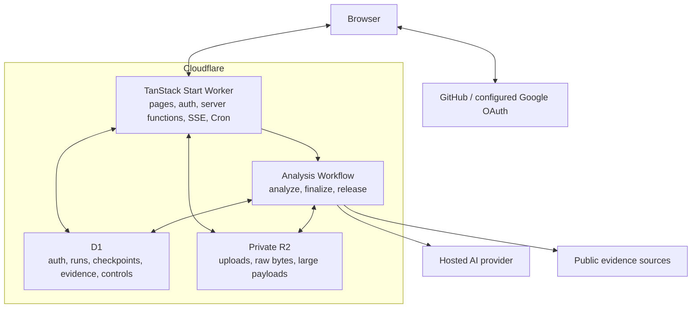

# Tracera

## Purpose

Tracera evaluates pasted text, public links, and screenshots against evidence it can name. It selects up to three checkable factual claims, reports each claim's verdict with exact evidence, and shows a scoped supported share only when the resolved evidence is sufficient.

Tracera also preserves report artifacts, related context, and immutable timelines of observed timestamps as new evidence appears.

## Features

- **Multi-format analysis:** Check news presented as text, links, or images through one verification flow.
- **Claim decomposition:** Break a story into atomic, individually verifiable factual claims instead of judging the article as a whole.
- **Scoped provenance:** Show earliest-observed source signals within the searched scope, with unknown history left unresolved.
- **Evidence-backed verdicts:** Cross-check each selected claim against applicable evidence and distinguish supporting, conflicting, and inconclusive states.
- **Evidence status:** Show evidence strength, applicability, independence, recency, and completeness separately from the claim verdict when those records exist.
- **Factual score:** Report the supported share of resolved selected claims only; source context, framing, provenance, and recency never become factual truth points.
- **Trace timelines:** Show immutable published, updated, event, indexed, archived, and captured observations with unknown times left unresolved.
- **Related context:** Similar stories remain context and do not stand in for evidence about the submitted claim.
- **Personal AI keys:** Save encrypted provider credentials in Settings, choose an active provider, and run analyses with your own generation and embedding keys.

## Stack

- **Toolchain:** Vite+ (`vp`), pnpm, TypeScript, Node.js 24 LTS
- **Website and server:** React, TanStack Start, one Cloudflare Worker
- **Data:** D1 through Drizzle, with large payloads and raw uploads in private R2
- **Execution:** Cloudflare Workflows for analysis, Cron for maintenance
- **Authentication:** Better Auth with D1 sessions and same-origin OAuth callbacks
- **AI:** Provider-neutral generation and embedding adapters for Gemini, OpenAI, OpenRouter,
  Anthropic, and OpenAI-compatible APIs

Tracera runs on Cloudflare at https://tracera.voltcrash.com, deployed after successful `main` CI.
Hosted sign-in offers Google and GitHub. Analysis requires configured platform providers or
an active personal AI key; otherwise it reports that it is unavailable.

## Quick start

Use Node.js 24 LTS and Vite+ (`vp`). From the repository root:

```sh
vp install
cp -n apps/web/.dev.vars.example apps/web/.dev.vars
chmod 600 apps/web/.dev.vars
vp run db:migrate
vp run dev
```

Open `http://localhost:3000`, choose Ada or Grace, and submit text, a public link, or a screenshot.
Local fixture analysis runs offline through real D1/R2 and Workflows. Keep an existing private
file when repeating setup. Cloudflare login, Docker, OAuth credentials, and paid provider keys
are unnecessary for this fixture workflow.

See [performance measurements](docs/performance.md) for benchmarks, transport sizes, and migration behavior.

Workspace scripts run through `vp run`. The website's scripts invoke the Vite+ built-ins
from `apps/web`, where its Vite and Wrangler configurations live.

```sh
vp check
vp test --run
vp run check-types
vp run build
vp exec --filter web --fail-if-no-match -- playwright install chromium
vp run test:browser
```

See [Cloudflare operations](docs/cloudflare-operations.md) for bindings, provider overrides,
explicit live budgets, migrations, and recovery. [Staging setup](docs/staging-setup.md) and
[production setup](docs/production-setup.md) cover hosted configuration and deployment.

See [bring your own key](docs/bring-your-own-key.md) for personal provider settings, encryption
setup and rotation, and hosted activation. Personal keys support every existing AI adapter;
platform providers remain available when no personal key is active.

## Architecture

One Worker serves pages, server functions, auth, and progress streaming on one origin.
D1 stores ownership-scoped runs, evidence, checkpoints, reports, sessions, admission limits,
and spend reservations. R2 stores uploads, raw acquisition bytes, and projections too large
for D1. Workflows resume from checkpoints after retries; scheduled maintenance cleans
expired control/auth rows and reconciles errored instances.

The analysis engine searches external sources and fetched evidence. Persisted claim vectors,
corpus retrieval, and stored embeddings are outside the current runtime.


