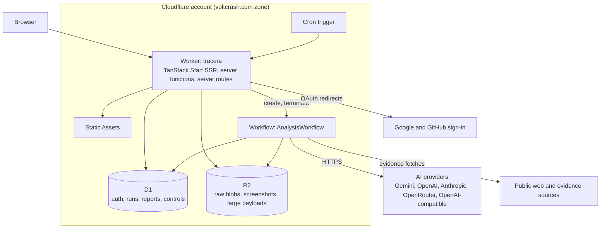

# Cloudflare migration plan

Status: production cut over to Cloudflare on 2026-10-12 as release `v26.10.12`, under D18
without an AI provider. Stages 0–3 and Phases 4.1–4.2 are complete. Phase 4.3 has removed Vercel
and passed both D1 restore drills; the Neon archive and deletion and the Vercel GitHub App
removal remain. Phase 4.4 enabled Google and GitHub sign-in on both origins on 2026-10-13; the
owner's sign-in round trips remain.

On 2026-10-12 the owner extended the live-test deferral through the remaining repository
implementation. Complete Stage 3 and prepare the Stage 4 runbooks before requesting the
provider configuration again. Keep the Phase 2.6 live exit criterion and Stage 4 hosted
sign-offs open; deployment, DNS, OAuth, and decommission actions still require approval.

Tracera moves from Next.js + Hono on Vercel with Neon Postgres to a single TanStack Start
application running on one Cloudflare Worker, backed by D1, R2, and Workflows. AI stays on the
existing provider-neutral layer (Gemini, OpenAI, Anthropic, OpenRouter, and OpenAI-compatible
APIs), called from the Worker, and provider selection is shaped so users can bring their own
API keys later. Local development and production follow the oxytype model: one Worker
codebase, one Wrangler config per hosted environment, `.dev.vars` files for secrets, and
Wrangler-managed D1 migrations.

## 1. Goals and non-goals

Goals:

- Serve the website, authentication, API, and analysis pipeline from one Worker on
  `tracera.voltcrash.com`.
- Replace Hono with TanStack Start server functions, server routes, and middleware.
- Replace Neon Postgres with D1, and the filesystem blob store with R2.
- Keep the AI provider layer and its current providers, running unchanged from the Worker,
  with provider selection behind one per-run resolver so bring-your-own-key (BYOK) can be added
  without reworking the pipeline.
- Run local development on the production runtime (workerd through the Cloudflare Vite
  plugin), and delete the Docker, profile, role, and generated-configuration tooling.

Non-goals:

- No change to analysis semantics, `@repo/contracts` report shapes, scoring, or visual design.
- No new product features beyond what the platform change requires (see D9 for local
  fixture analysis).
- BYOK itself ships after the migration; section 7 describes it.

## 2. What changes

| Concern            | Today                                                                                    | Target                                                                                         |
| ------------------ | ---------------------------------------------------------------------------------------- | ---------------------------------------------------------------------------------------------- |
| Framework          | Next.js 16 App Router, RSC, `proxy.ts`                                                   | TanStack Start (React 19, file routes, SSR), built by Vite+                                    |
| API                | Hono app behind `app/api/[[...route]]`                                                   | Start server functions for UI calls, server routes for HTTP-shaped endpoints, Start middleware |
| Hosting            | Vercel project, Node runtime, `maxDuration` 300 s                                        | One Worker with Workers Static Assets and a custom domain                                      |
| Database           | Neon Postgres 18 via `pg` and Neon serverless, 30 SQL migrations, roles and grants       | D1 via Drizzle's `d1` driver, one new baseline migration                                       |
| AI                 | Gemini, OpenAI, Anthropic, OpenRouter, OpenAI-compatible adapters; config read from env  | Same adapters and keys, called with `fetch` from the Workflow; config from a per-run resolver  |
| Embeddings         | pgvector `vector(1024)` table that nothing writes                                        | Not ported; the embedding port stays for future use (D13)                                      |
| Raw blobs          | Filesystem store                                                                         | R2 bucket                                                                                      |
| Analysis execution | Inside `POST /analyze`, with Postgres job leases, fencing tokens, and renew timers       | One Workflow instance per run; the request returns the run ID                                  |
| Maintenance        | None                                                                                     | Cron trigger on the same Worker                                                                |
| Configuration      | `@repo/environment` profiles and roles, sealed files under `.tracera/`, `TRACERA_*` vars | `wrangler.jsonc` vars and `.dev.vars`; `wrangler.production.json` and `.dev.vars.production`   |
| Local data         | Per-worktree Docker Postgres clusters with generated ports and passwords                 | Miniflare D1, R2, and Workflows in `apps/web/.wrangler/state`, isolated per worktree           |
| Integration tests  | Docker Postgres rehearsal, grants audit, node-postgres suites                            | Miniflare D1 suites applying the real migrations (oxytype `createTestRuntime` pattern)         |
| Deployment         | Vercel Git integration, deploying every push to `main`                                   | Daily oxytype-style release workflow running `wrangler deploy` with a scoped API token         |
| Existing data      | Neon production database                                                                 | Fresh start on an empty D1; a final Neon dump is archived in R2                                |

## 3. Target architecture



### Bindings and resources

| Binding             | Type                         | Staging and local (`wrangler.jsonc`)                | Production (`wrangler.production.json`) |
| ------------------- | ---------------------------- | --------------------------------------------------- | --------------------------------------- |
| Worker              | Worker name                  | `tracera-staging.voltcrash.workers.dev`             | `tracera` (custom domain only)          |
| `DB`                | D1                           | `tracera-staging` (local copy in `.wrangler/state`) | `tracera-production`                    |
| `BLOBS`             | R2                           | `tracera-staging-blobs` (local copy)                | `tracera-production-blobs`              |
| `ANALYSIS_WORKFLOW` | Workflow, `AnalysisWorkflow` | `tracera-staging-analysis` (local copy)             | `tracera-production-analysis`           |
| `ASSETS`            | Static assets                | managed by the Cloudflare Vite plugin               | same                                    |

Every binding has a local Miniflare copy, so local development never needs a Cloudflare login.
Both configs set `compatibility_flags: ["nodejs_compat"]`, `observability.enabled`, and a cron
trigger. Production disables `workers_dev` and preview URLs and routes `tracera.voltcrash.com`
as a custom domain.

### Source layout after migration

```text
apps/web/
  vite.config.ts               # vite-plus defineConfig: cloudflare(), tanstackStart(), react(), tailwindcss()
  wrangler.jsonc               # default: staging resources, used locally with local data
  wrangler.production.json     # production, used only by explicit production scripts
  .dev.vars.example            # committed local defaults; copied to ignored .dev.vars
  .dev.vars.production.example # committed placeholders; real file is ignored, mode 0600
  worker-configuration.d.ts    # `wrangler types` output
  public/                      # favicon, icons, OG image
  src/
    server.ts                  # Worker entry: Start fetch, scheduled, AnalysisWorkflow export
    start.ts                   # createStart: global request and function middleware
    router.tsx
    routeTree.gen.ts           # generated by the Start plugin
    routes/                    # pages and /api server routes
    server/                    # env, auth, middleware, server functions, workflow, cron
    components/ lib/ styles/   # ported with minimal changes
packages/
  ai/                # existing providers, provider resolver, R2 blob store, Worker-safe fetch
  auth/              # Better Auth on D1
  contracts/         # unchanged
  db/                # Drizzle sqlite schema, D1 repositories, migrations/
  typescript-config/ # nextjs.json removed
```

## 4. Local and production model (oxytype pattern)

1. One Worker codebase. Environment differences live only in Wrangler config and secrets files.
2. `apps/web/wrangler.jsonc` is the default config. It names the staging resources, and local
   development uses local copies of them (D1, R2, and Workflows run in Miniflare). Its `vars`
   hold staging values.
3. Ignored `apps/web/.dev.vars`, copied from the committed `.dev.vars.example`, overrides vars
   and supplies secrets for local development only: `MODE=dev`, `ANALYSIS_MODE=fixture`,
   `DEV_AUTH_BYPASS=true`, and a fixed local-only `BETTER_AUTH_SECRET`. The example lists the
   `AI_*` settings commented out for `dev:live`.
4. `apps/web/wrangler.production.json` is a separate, explicit config with isolated resources,
   `secrets.required`, and the custom-domain route. It is never the default.
5. Production secrets live in ignored `apps/web/.dev.vars.production` (mode 0600) and are
   uploaded with `wrangler deploy --secrets-file`. CI writes that file from one GitHub secret
   and deletes it afterwards, even on failure.
6. `check:production` validates the production config, secrets file, and build before every
   production deploy (a port of oxytype's `production-inputs.ts`): resource names and IDs differ
   from staging, one HTTPS origin, `MODE=production`, no `DEV_AUTH_BYPASS`, no fixture mode,
   no placeholder or local secrets, a long enough auth secret, a complete GitHub OAuth pair,
   and a complete AI provider configuration (the same rules the runtime policy enforces
   today). During the D17 deferral, Google credentials may both be absent; a partial Google
   pair always fails validation. Google is omitted from `secrets.required` until Phase 4.4,
   which makes both OAuth pairs required before enabling Google sign-in.
7. `MODE` (`dev` or `production`) is the only runtime switch. It replaces `TRACERA_PROFILE`,
   `TRACERA_CONFIG_ROLE`, and `NODE_ENV` checks. Dev-only behavior requires `MODE=dev` and a
   loopback request origin.
8. Server code reads bindings with `import { env } from "cloudflare:workers"`, validated once by
   `apps/web/src/server/env.ts` with Zod. There is no `process.env` and no `.env` loading.

Parallel worktrees need no generated configuration: each worktree keeps its own
`apps/web/.wrangler/state`. The dev server prefers port 3000 and Vite moves to the next free
port when it is taken. In dev, Better Auth derives its base URL from the loopback request
origin, so any port works; production uses the fixed `BETTER_AUTH_URL`.

Live AI locally is opt-in: `dev:live` sets `ANALYSIS_MODE=live` and uses the provider settings
in `.dev.vars`. This relaxes today's rule that local profiles reject provider credentials;
`.dev.vars` is ignored by Git and never uploaded.

The Cloudflare Vite plugin bakes the selected Wrangler config into `dist/server/wrangler.json`.
`build:production` selects `wrangler.production.json` through the plugin's
`CLOUDFLARE_VITE_WRANGLER_CONFIG_PATH`, and deploys pass that built config to Wrangler: an
explicit source config would make Wrangler rebundle `src/server.ts` without Vite. Because
`.dev.vars` always overrides config vars, `dev:live` runs Vite in its `live` mode and
`serverEnv()` switches `ANALYSIS_MODE` to `live` only in that dev mode (Phase 2.1 amendment).

### Commands

Run from the repository root with `vp run <script>` unless noted.

| Task                 | Command                                                                      | What it does                                                                                 |
| -------------------- | ---------------------------------------------------------------------------- | -------------------------------------------------------------------------------------------- |
| First-time setup     | `vp install`, copy `apps/web/.dev.vars.example` to `.dev.vars`, `db:migrate` | Installs, configures, and migrates local D1                                                  |
| Develop              | `dev`                                                                        | `vp dev` in `apps/web`: Vite and workerd with HMR, local D1, R2, and Workflows               |
| Develop with live AI | `dev:live`                                                                   | Same in Vite's `live` mode, which switches to `ANALYSIS_MODE=live` with `.dev.vars` keys     |
| Generate migration   | `db:generate`                                                                | `drizzle-kit generate` with the sqlite dialect                                               |
| Migrate local        | `db:migrate`                                                                 | `wrangler d1 migrations apply tracera-staging --local`                                       |
| Reset local data     | `db:reset`                                                                   | Deletes this worktree's local D1 state and migrates again                                    |
| Binding types        | `cf-typegen`                                                                 | `wrangler types`                                                                             |
| Check and test       | `vp check`, `vp test`                                                        | Format, lint, types, unit and Miniflare D1 suites                                            |
| Build and preview    | `build`, `preview`                                                           | `vp build`, then `vp preview` runs the built Worker in workerd                               |
| Deploy staging       | `deploy:staging`                                                             | Remote staging migrations, build, then `wrangler deploy` of the built config                 |
| Check production     | `check:production`                                                           | `build:production`, then validates production config, secrets, and the built config          |
| Production dry run   | `deploy:production-dry-run`                                                  | Check, then `wrangler deploy --config dist/server/wrangler.json --secrets-file … --dry-run`  |
| Migrate production   | `db:migrate:production`                                                      | `wrangler d1 migrations apply tracera-production --remote --config wrangler.production.json` |
| Deploy production    | `deploy:production`                                                          | Check, then deploy the built production config with the secrets file                         |

### Variables

| Today                                                                                                                                                                           | Target                                                             |
| ------------------------------------------------------------------------------------------------------------------------------------------------------------------------------- | ------------------------------------------------------------------ |
| `BETTER_AUTH_SECRET`                                                                                                                                                            | Secret (`.dev.vars` locally)                                       |
| `GOOGLE_CLIENT_ID`, `GOOGLE_CLIENT_SECRET`, `GITHUB_CLIENT_ID`, `GITHUB_CLIENT_SECRET`                                                                                          | Secrets in staging and production only                             |
| `AI_PROVIDER`, `AI_MODEL`, `AI_BASE_URL`, `AI_EMBEDDING_PROVIDER`, `AI_EMBEDDING_MODEL`, `AI_EMBEDDING_BASE_URL`                                                                | Unchanged; Wrangler vars (`.dev.vars` locally)                     |
| `AI_API_KEY`, `AI_EMBEDDING_API_KEY`                                                                                                                                            | Unchanged; secrets (`.dev.vars` locally)                           |
| `GOOGLE_FACT_CHECK_API_KEY`, `NEWS_API_KEY`                                                                                                                                     | Optional secrets (D4)                                              |
| `DEV_AUTH_BYPASS`                                                                                                                                                               | `.dev.vars` only; rejected by `check:production`                   |
| `TRACERA_ANALYSIS_MODE`                                                                                                                                                         | `ANALYSIS_MODE` (`fixture` or `live`)                              |
| `ANALYSIS_*` limits, `AI_DAILY_SPEND_LIMIT_USD`, `AI_ESTIMATED_*_COST_USD`                                                                                                      | Optional vars; code defaults unchanged                             |
| —                                                                                                                                                                               | New: `MODE`, `BETTER_AUTH_URL`, `VERSION`                          |
| —                                                                                                                                                                               | Later, for BYOK: secret `PROVIDER_KEYS_ENCRYPTION_KEY` (section 7) |
| `TRACERA_PROFILE`, `TRACERA_CONFIG_ROLE`, `TRACERA_CONFIG_SEAL`, `TRACERA_CONFIG_SOURCE`, `TRACERA_WORKTREE_ID`, `TRACERA_DATABASE_*`, `TRACERA_APP_ORIGIN`, `TRACERA_APP_PORT` | Removed                                                            |
| `DATABASE_URL`, `DATABASE_MIGRATOR_URL`, `TEST_DATABASE_PROVISIONER_URL`, `ANALYSIS_STORAGE_TEST_DATABASE_URL`                                                                  | Removed; D1 is a binding                                           |

## 5. Decisions

| ID  | Decision                 | Recommendation                                                                                                                                                                                                                                                                                                                                                                                                                                                                                                  | Status   |
| --- | ------------------------ | --------------------------------------------------------------------------------------------------------------------------------------------------------------------------------------------------------------------------------------------------------------------------------------------------------------------------------------------------------------------------------------------------------------------------------------------------------------------------------------------------------------- | -------- |
| D1  | Delivery strategy        | Stages 0–1 are additive and merge to `main` (Vercel keeps serving). Stages 2–3 land as one PR per phase into `migrate/cloudflare`. `main` and Vercel stay untouched until cutover; freeze feature work on `main` meanwhile.                                                                                                                                                                                                                                                                                     | Accepted |
| D2  | API surface              | Server functions for everything the React UI calls. Server routes only where the HTTP shape matters: `/api/auth/$`, SSE progress, evidence download, health. No CORS: dev and production are both same-origin.                                                                                                                                                                                                                                                                                                  | Accepted |
| D3  | Analysis execution       | Workflows. `startAnalysis` returns the run ID and the run page streams progress. Retires the Postgres job queue, leases, fencing renewals, timers, and outbox.                                                                                                                                                                                                                                                                                                                                                  | Accepted |
| D4  | Cloudflare boundary      | All infrastructure runs on Cloudflare. AI providers stay external by choice: Workers AI behind AI Gateway costs more for this workload, and external providers keep BYOK possible. Sign-in providers and the pages being checked are inherently external. Google News RSS, GDELT, Google Fact Check, and NewsAPI stay as evidence sources.                                                                                                                                                                      | Accepted |
| D5  | AI providers             | Keep the provider-neutral `AiProvider` layer and the Gemini, OpenAI, Anthropic, OpenRouter, and OpenAI-compatible adapters, plus the D1 spend circuit. No Workers AI, AI Gateway, or model bake-off.                                                                                                                                                                                                                                                                                                            | Accepted |
| D6  | Existing production data | Fresh start. New D1 baseline (Postgres migrations are not ported) and no data import. Production gets a new `BETTER_AUTH_SECRET`; users sign in again with Google or GitHub, and earlier reports are not carried over. A final `pg_dump` is archived in R2 before Neon is deleted.                                                                                                                                                                                                                              | Accepted |
| D7  | Concurrency on D1        | Atomic `batch()` calls with guarded statements and optimistic version columns, as in oxytype. No interactive transactions. A Durable Object only if a guard cannot be expressed in one batch.                                                                                                                                                                                                                                                                                                                   | Accepted |
| D8  | Config layout            | Separate `wrangler.production.json` instead of Wrangler `env` blocks; secrets through `--secrets-file`. Mirrors oxytype.                                                                                                                                                                                                                                                                                                                                                                                        | Accepted |
| D9  | Local analysis           | `MODE=dev` with `ANALYSIS_MODE=fixture` runs the deterministic scripted ports end to end, so the whole UI works offline. `live` is opt-in with your own key in `.dev.vars`. Production rejects fixture mode.                                                                                                                                                                                                                                                                                                    | Accepted |
| D10 | Test runtime             | Miniflare inside Vitest (oxytype) rather than `@cloudflare/vitest-pool-workers`, to stay on Vite+'s bundled Vitest.                                                                                                                                                                                                                                                                                                                                                                                             | Accepted |
| D11 | Fonts                    | Self-host Newsreader with `@fontsource-variable/newsreader`; keep the local Geist files. No Google Fonts download at build time.                                                                                                                                                                                                                                                                                                                                                                                | Accepted |
| D12 | Database privileges      | Postgres roles, grants, and the RLS analysis are retired. Only the Worker binding can reach D1; migrations use a scoped API token. Application-level tenant, owner, and visibility filters stay.                                                                                                                                                                                                                                                                                                                | Accepted |
| D13 | Embeddings               | Do not port `core_snapshot_embeddings`: no engine stage calls the embedding port and nothing writes the table. Keep `EmbeddingPort` and `embed()`. Add storage when a feature first queries embeddings: a D1 BLOB column for small volumes, Vectorize for similarity search at scale.                                                                                                                                                                                                                           | Accepted |
| D14 | BYOK readiness           | Analysis resolves its provider inside workflow steps through `resolveAnalysisProvider({ userId })`, which returns `{ source: "platform", config }` until BYOK ships. API keys never enter workflow params, step results, run rows, reports, or logs. Runs record provider source, provider, and model.                                                                                                                                                                                                          | Accepted |
| D15 | Staging origin           | `https://tracera-staging.voltcrash.workers.dev`, the account's workers.dev subdomain as oxytype staging uses. It serves the site and API together, so OAuth cookies stay first-party.                                                                                                                                                                                                                                                                                                                           | Accepted |
| D16 | Production releases      | A daily release like oxytype's: a scheduled workflow deploys `main` once a day when there are new commits, tags a `YY.MM.DD` version, and publishes GitHub release notes. Merging to `main` does not deploy by itself.                                                                                                                                                                                                                                                                                          | Accepted |
| D17 | Google OAuth timing      | Google OAuth registration, hosted credentials, and live sign-in checks move to the final Phase 4.4, after the other migration phases. Earlier phases and the initial Cloudflare rollout use GitHub sign-in. Google implementation and stubbed tests remain in scope; partial credential pairs are rejected.                                                                                                                                                                                                     | Accepted |
| D18 | Rollout without AI       | The owner deferred AI provider settings, local and hosted live analysis checks, and the live evaluation until a later date (2026-10-12). Staging and production deploy without a provider; analysis reports `analysis_unavailable` until a complete provider configuration and every run and spend bound are added. `check:production` accepts no AI settings, rejects partial ones, and `AI_API_KEY` leaves `secrets.required`. Soak observation windows and the stable period before decommission are waived. | Accepted |

## 6. Stages and phases

Each phase is one pull request. Every pull request passes `vp check` and `vp test`; tests for a
removed subsystem leave with that subsystem, and their replacement coverage lands in the same
or the named next phase.

### Stage 0 — Decide and prove

No product code lands in this stage.

**Phase 0.1 — Confirm decisions.** D4–D6, D15, and D16 are accepted. Confirm or amend the
decisions still marked proposed. Exit: every decision in section 5 is accepted.

**Phase 0.2 — Toolchain spike (throwaway branch).** Build a minimal TanStack Start app in this
workspace with `vp dev` and `vp build` using `@cloudflare/vite-plugin` on Vite+'s Vite core.
Prove:

- SSR and HMR inside workerd; Tailwind v4 through `@tailwindcss/vite`.
- `routeTree.gen.ts` generation and `vp check` type-aware lint with generated files.
- A custom `src/server.ts` exporting a `WorkflowEntrypoint` and a `scheduled` handler.
- Local D1 through Drizzle, and Better Auth's sqlite adapter on D1 with `tanstackStartCookies()`.
- A per-request CSP nonce applied to Start's inline scripts.
- A structured-output call to each configured AI provider from a step in a deployed staging
  Worker, confirming the provider accepts requests from Cloudflare's network (see risks).

Record any Vite+ incompatibility and its fix on current versions; no downgrades. Exit: written
spike notes and a go or no-go.

Phase 0.2 result (2026-10-11): **GO** for the confirmed empty provider configuration.
[Spike notes](cloudflare-stage-0-spike.md) record the tested versions, fixes, local runtime
evidence, validation, and reproducible throwaway revision. The deployed AI probe is not
applicable because the owner confirmed no configured providers; run it before enabling any
live provider. Hosted R2 activation was verified during Phase 0.3.

**Phase 0.3 — Cloudflare resources.** Create the staging and production resources in
section 3. Register the staging GitHub OAuth app with homepage
`https://tracera-staging.voltcrash.workers.dev` and callback
`https://tracera-staging.voltcrash.workers.dev/api/auth/callback/github`. Google registration
and credentials belong to Phase 4.4 under D17. Generate new
staging and production `BETTER_AUTH_SECRET` values. Create a CI API token scoped to Workers, D1,
R2, Workflows, and the custom domain. Exit: resource names and IDs ready for the Wrangler
configs.

Phase 0.3 result (2026-10-12): **PASS; Stage 0 complete under D17**.
[Resource notes](cloudflare-stage-0-resources.md) record the verified names and IDs,
approved bootstrap deployments, and new private staging/production auth secrets.
The owner completed GitHub staging OAuth and CI token creation. GitHub credentials are
present in the private mode-0600 staging file. The CI token is active, its scoped policy
matches the prepared settings, and read-only checks of the intended resources pass.
The owner moved Google staging OAuth to the final Phase 4.4; it no longer blocks Stage 0
or the intervening phases. Stage 1 implementation is recorded below.
Production custom-domain activation remains a Stage 4 cutover action.

### Stage 1 — Cloudflare foundations in shared packages

Additive changes merged to `main`. Nothing on Vercel changes.

**Phase 1.1 — Worker-safe `@repo/ai` runtime.**

- Share `safeFetch` URL and redirect validation across two runtime transports: Web `fetch`
  with `redirect: "manual"` for the `workerd` package condition, and the existing pinned Node
  HTTP transport by default for Vercel. Both validate protocol and port allowlists, hostname
  and IP-literal blocklists, and resolved addresses through `node:dns` on every hop. The Worker
  bundle excludes `node:http`, `node:https`, `node:net`, and `node:stream`; Vercel retains DNS
  pinning until Phase 2.1 switches the app runtime. Workers cannot reach private networks, so
  their transport does not need DNS pinning. The owner accepted this rollout correction on
  2026-10-12 to preserve Vercel's protection during additive Stage 1 work.
- The provider adapters already call `safeFetch` and honor `AbortSignal`, so they run on
  Workers unchanged once `safeFetch` does.
- Add `createR2RawBlobStore(bucket)` implementing `RawBlobStore`, with content-addressed keys
  (`snapshots/<snapshotId>/<sha256>`) and `r2://` URIs. The filesystem store moves to test
  support.
- Confirm Cheerio bundles for workerd without its Node-only fetching path; `node:crypto`
  `createHash` stays under `nodejs_compat`.

Exit: package tests pass, and a Miniflare smoke test runs ingestion and each provider adapter
(against a stubbed upstream) through `safeFetch`.

**Phase 1.2 — Provider resolver (BYOK seam).**

- Move provider selection out of `analysisRuntimePolicy` into
  `resolveAnalysisProvider({ userId, env })`. Today it returns `{ source: "platform", config }`
  from Worker vars and secrets, with the current validation (paired keys, required base URLs,
  and a separate embedding provider for Anthropic).
- The run context records the provider source and provider next to the model it already stores.
- Spend rows are keyed by provider and key source, so platform limits never apply to user keys
  later.
- Provider errors and logs are redacted: no request headers or keys. Adapters already send keys
  in headers; a test keeps it that way.

Exit: unit tests cover resolver validation and redaction; existing provider tests pass.

**Phase 1.3 — D1 schema and baseline migration.**

- `packages/db/src/d1/schema.ts` defines every live table with `sqliteTable` using the mappings
  in appendix B. Left out: tables that exist only for in-request execution (`core_jobs`,
  `core_outbox`, lease columns), because Workflows own execution (D3), and
  `core_snapshot_embeddings` (D13).
- Better Auth's sqlite tables are generated with the Better Auth CLI and reconciled into the
  schema.
- A sqlite Drizzle config generates `packages/db/migrations/0000_baseline.sql`; both Wrangler
  configs point `migrations_dir` at that folder.

Exit: migrations apply cleanly through Miniflare and `wrangler d1 migrations apply --local`.

**Phase 1.4 — D1 repositories.**

- Implement the analysis repository on D1: run creation, checkpoints, snapshots, finalize,
  report reads, run progress and history, and cancellation. A `fencing_token` on the run row,
  updated conditionally, guards finalization.
- Implement analysis admission and provider spend (`beginAnalysisAdmission`,
  `finishAnalysisAdmission`, `reserveProviderSpend`, `settleProviderSpend`) as single atomic D1
  batches using guarded `INSERT … ON CONFLICT … DO UPDATE … WHERE … RETURNING`. Clock values and
  UTC day keys come from code.
- Apply the rewrite rules in appendix C.

Exit: Miniflare D1 suites ported from `analysis-storage.integration.test.ts` and
`postgres.integration.test.ts` pass, including rate, concurrency, quota, cooldown, idempotent
replay, and spend-circuit behavior under concurrent batches.

**Phase 1.5 — Better Auth on D1.**

- `createAuth({ db, env, origin })` uses `drizzleAdapter(db, { provider: "sqlite" })` and keeps
  the `tracera` cookie prefix, OAuth token encryption, token-discarding hooks, and Google and
  GitHub provider implementations. Under D17, Google is enabled only with a complete
  credential pair; missing Google credentials allow GitHub sign-in until Phase 4.4.
  Stubbed tests cover both provider configurations and reject a partial Google pair.
- The dev-login plugin requires `MODE=dev`, `DEV_AUTH_BYPASS=true`, and a loopback origin.
- `tanstackStartCookies()` is the last plugin. `@repo/environment` assertions are replaced by
  typed input.

Exit: ported `dev-auth-bypass` and `auth-token-storage` tests pass against Miniflare D1.

Stage 1 result (2026-10-12): **PASS locally; implementation complete, pending PR review**.
The phase stack is [#36](https://github.com/voltcrash/tracera/pull/36) →
[#37](https://github.com/voltcrash/tracera/pull/37) →
[#38](https://github.com/voltcrash/tracera/pull/38) →
[#39](https://github.com/voltcrash/tracera/pull/39) →
[#40](https://github.com/voltcrash/tracera/pull/40). The final local run has 298 passing tests;
47 D1 repository/schema tests and 25 D1 auth tests pass without skips. Existing Postgres
integration cases run in hosted Docker CI. [Evidence and Stage 2 handoff](cloudflare-stage-1-foundations.md)
record the approved Phase 1.1 transport amendment and additive package entries. No hosted
resources, secrets, deployments, DNS or OAuth apps were changed during Stage 1.

### Stage 2 — The app on TanStack Start and Workers

Pull requests target `migrate/cloudflare`.

Stage 3 proceeds while the owner-deferred live-provider check remains pending. When removing
legacy tooling in Phase 3.1, remove its calls from the transitional CI in the same PR so every
phase stays green. Phase 3.3 replaces that workflow and adds production release automation.

Progress and evidence: [Stage 2 notes](cloudflare-stage-2-app.md).

**Phase 2.1 — Framework swap and the oxytype config model.**

- Remove `next`, `next.config.js`, `postcss.config.mjs`, `src/proxy.ts`, the Next agent notes
  in `apps/web/AGENTS.md` and `apps/web/CLAUDE.md`, and the root `next` dev dependency.
- Remove the temporary pinned Node `safeFetch` transport and its conditional package mapping
  after switching this branch's app to Workers; `safeFetch` then uses only the Worker transport.
- Add TanStack Start, TanStack Router, `@cloudflare/vite-plugin`, `@vitejs/plugin-react`,
  `@tailwindcss/vite`, and `wrangler` with `vp add` at their latest versions.
- Add `vite.config.ts`, both Wrangler configs, both `.dev.vars` examples, `src/server.ts`,
  `src/start.ts`, `src/router.tsx`, `src/server/env.ts`, the scripts in section 4, and ignore
  rules for `.wrangler/` and real `.dev.vars*` files.

Exit: `dev`, `build`, `preview`, and `wrangler deploy --dry-run` work, and a placeholder page is
served from workerd with local D1 migrated.

**Phase 2.2 — Pages, layout, and navigation.**

- Port routes and Next APIs per appendix A.
- The root route renders `<html>`, `head()` metadata (title, Open Graph, Twitter, theme color,
  icons), fonts, the theme bootstrap script with the nonce, and the providers.
- Remove the 25 `"use client"` directives; set `rsc: false` and the new CSS path in
  `components.json`; move icons and the Open Graph image to `public/`.
- The `_workspace` layout's `beforeLoad` calls a `getSession` server function and redirects
  anonymous users to `/`; `/` redirects signed-in users to `/home`. This replaces `proxy.ts`.

- Hosted sign-in offers only providers enabled by complete credential pairs. Under D17,
  the initial hosted page offers GitHub; Google appears when Phase 4.4 enables it. UI tests
  cover GitHub-only and both-provider configurations without hosted Google credentials.

Exit: every page renders under `vp dev` with navigation parity, and sign-in offers the
configured providers.

**Phase 2.3 — Auth endpoints.**

- `src/routes/api/auth/$.ts` handles GET and POST with `auth.handler(request)` and keeps the
  existing mapping of 5xx responses to the generic error body.
- Dev identities stay a dev-only Better Auth plugin endpoint. `authClient` is unchanged.

Exit: local sign-in as `ada@tracera.local` and `grace@tracera.local` works, persists across
reloads, and signs out.

**Phase 2.4 — Server layer replacing Hono.**

| Hono today                                                        | TanStack Start                                                                                                  |
| ----------------------------------------------------------------- | --------------------------------------------------------------------------------------------------------------- |
| `requestIdMiddleware`, `onError`                                  | Global request middleware: request ID header, JSON error envelope, server-function error mapping                |
| Security headers and CSP in `server.ts` and `proxy.ts`            | Global request middleware with a per-request nonce                                                              |
| `private, no-store` for authenticated or cookie-setting responses | Same global middleware                                                                                          |
| `cors()` and `cors-origin.ts`                                     | Removed                                                                                                         |
| `authenticatedUser` and the per-request `WeakMap` cache           | `authMiddleware` function middleware putting `user` in context                                                  |
| `configureDatabase(...)` per request                              | `db()` from `env.DB`                                                                                            |
| `GET /api/tracera/`                                               | Removed                                                                                                         |
| `GET /auth/me`                                                    | `getMe` server function                                                                                         |
| `GET /health`                                                     | `/api/health` server route                                                                                      |
| `POST /analyze`                                                   | `startAnalysis` server function: input and idempotency key in, `{ runId, status }` or a typed control error out |
| `GET /runs`, `GET /runs/:id`, `POST /runs/:id/cancel`             | `listRuns`, `getRun` (also used by the route loader), `cancelRun`                                               |
| `GET /runs/:id/events`                                            | `/api/runs/$id/events` server route, same SSE event format                                                      |
| `GET /runs/:id/evidence/:snapshotId`                              | `/api/runs/$id/evidence/$snapshotId` server route reading D1 and R2                                             |

The 7.1 MB analysis body limit moves into the `startAnalysis` input validator. Route loaders
replace fetch-on-mount where it simplifies a page; no new data library is added.

Exit: ported `analysis-api`, `error-handling`, and route-guard tests pass by invoking server
function and route handlers against a Miniflare environment.

**Phase 2.5 — Analysis on Workflows.**

- Export `AnalysisWorkflow extends WorkflowEntrypoint` from `src/server.ts` and bind it in both
  configs.
- `startAnalysis` admits the request in one D1 batch, stores screenshots and other large inputs
  in R2, creates the run row, calls `env.ANALYSIS_WORKFLOW.create({ id: runId, params })`, and
  returns the run ID. Using the run ID as the instance ID makes starts idempotent.
- Params carry only the run ID and input references. Workflows persist params and step results
  (up to 1 MiB each) for the retention period, so they never contain API keys or raw uploads.
- The workflow calls `resolveAnalysisProvider` inside its step, then runs `step.do("analyze")`
  with retries and a timeout of `ANALYSIS_MAX_ELAPSED_MS`. The engine already checkpoints each
  stage, so a retried step resumes after the last completed stage. `step.do("finalize")` writes
  the report and `step.do("release")` stores the idempotent response, releases the admission
  lease, and settles spend. Splitting each engine stage into its own step is an optional
  follow-up.
- `cancelRun` sets the D1 cancellation flag, which the engine already observes, and terminates
  the instance after a grace period.
- Admission leases cover the bounded Workflow retry window; failure, finalize, and release steps
  each have two retries and a 30-second attempt timeout. No lease renewal timer is needed.
- Removed: `acquireLease`, `renewLease`, `acquireNextLease`, the renew and cancellation timers,
  and `process.pid` worker IDs.
- In fixture mode the workflow uses the scripted ports from `packages/ai/scripts/support`.
- The home page navigates to `/run/$id` after `startAnalysis` (landed in Phase 2.4 with the
  new response shape); the run page shows live progress and then the report.

Exit: a local fixture analysis completes end to end in `vp dev`, cancellation works, and an
injected failure resumes from its checkpoint.

**Phase 2.6 — Retrieval and evidence on Workers.** The live search ports keep their behavior on
the new `safeFetch`. Fact Check and NewsAPI keys stay optional secrets (D4). Raw blobs go to
R2. Browser Rendering is added only if staging shows acquisition gaps on script-rendered pages.
Exit: `dev:live` completes an analysis with a provider key from `.dev.vars`.

The owner deferred this live-provider validation on 2026-10-12 until credentials can be
configured. Implement and validate the remaining Stage 2 phases meanwhile; leave this exit
criterion pending and do not replace the live check with stubbed evidence.

**Phase 2.7 — Scheduled maintenance.** The `scheduled` handler purges expired idempotency keys,
released and expired leases, old rate windows, expired sessions and verifications, and stale
spend reservations, and marks runs whose workflow instance errored as failed. Exit: covered by
Miniflare tests and runnable locally.

**Phase 2.8 — Browser tests.** Playwright starts `vp dev` on a fixed port with `--strictPort`
and cleans its synthetic users with `wrangler d1 execute --local`. `local-auth.e2e.ts` and
`focused-acceptance.e2e.ts` are ported; acceptance can use fixture analysis instead of mocking
the API. Exit: both suites pass locally and in CI.

### Stage 3 — Remove the old stack, docs, and CI/CD

Pull requests target `migrate/cloudflare`.

On 2026-10-12 the owner confirmed that `vercel.json` stays deleted despite legacy Vercel
preview failures. Cloudflare CI remains the migration validation gate. Do not restore the
branch guard or change hosted Vercel settings during Stage 3; Git deployment disablement
remains in Phase 4.2.

**Phase 3.1 — Delete legacy code and dependencies.**

- Hono: removed in Phase 2.4 once its replacement landed, together with the `hono`
  dependency.
- Postgres: `packages/db/src/connection.ts`, the Postgres schema, `packages/db/drizzle/` (30 SQL
  migrations and their snapshots), `@neondatabase/serverless`, `pg`, `@types/pg`, and Postgres tests.
  D1 modules move from `src/d1/` to `src/`.
- Environment tooling: `packages/environment`, `scripts/environment`, `scripts/database`,
  `scripts/local`, `scripts/auth/test-browser.mjs`, `config/environment`, root `.env.example`,
  and the `.tracera/` ignore rule.
- The `packages/ai` evaluation scripts drop the `guard.mjs` wrapper. Fixture evaluators need no
  settings; live evaluation reads provider settings from the invoking shell.
- Vercel and Next: `vercel.json`, `.vercel` and `.next` ignore rules, and
  `packages/typescript-config/nextjs.json`. The oxlint `nextjs` plugin left with Next in
  Phase 2.1, because its rules reject Start's document `<head>`.
- Update `pnpm-workspace.yaml` `allowBuilds` for the new dependency set and trim root scripts to
  section 4.

Exit: `vp install`, `vp check`, `vp test`, and `build` pass, and no source references Next,
Hono, Neon, `pg`, Vercel, `DATABASE_URL`, or `TRACERA_PROFILE`.

**Phase 3.2 — Documentation.** Rewrite the README stack, architecture diagram, and quick start.
Replace `docs/environment.md` and `docs/local-development.md` with oxytype-style
`docs/cloudflare-operations.md` (local development, bindings, secrets, migrations, staging
deploys, recovery, D1 Time Travel), `docs/production-setup.md`, and `docs/staging-setup.md`.
Keep the AI provider override documentation. Record implementation progress while leaving
Stage 4 rollout gates, including the final Google OAuth phase, open.

**Phase 3.3 — CI and production release.**

The original release policy in this completed migration stage is historical. Current production
deployments follow successful main-push CI without website release tags or changelogs; see
[production setup](production-setup.md).

- `.github/workflows/ci.yml` replaces `local-development.yml`: install, Chromium, `vp check`,
  `vp test` under `with-network-denied.sh`, `build`, `wrangler deploy --dry-run` for both
  configs, and Playwright against `vp dev`. No Docker.
- `.github/workflows/production-release.yml` is oxytype's daily release (D16):
  - Runs on a daily schedule (oxytype uses `17 0 * * *`) and on manual dispatch from `main`,
    one run at a time, in a `production` environment with `CLOUDFLARE_API_TOKEN` and
    `PRODUCTION_WORKER_ENV` (the contents of `.dev.vars.production`, including the AI keys).
  - Planning skips install, build, migrations, and deploy when `main` has no commits since the
    last successful release. Otherwise it picks the `YY.MM.DD` version and `v`-prefixed tag, and
    stops if that tag already belongs to another commit.
  - Deploy writes the secrets file with mode 0600, then runs `check:production`, build, dry run,
    `db:migrate:production`, and deploy with `--var VERSION:<version>`, and always deletes the
    file.
  - After a successful deploy it tags the deployed commit and publishes a GitHub release whose
    notes group commits since the previous release into Features, Improvements, Fixes, and
    other changes, leaving out merge commits.
  - It never bootstraps or resets D1.
- Port oxytype's release helpers (`production-release.js`, `daily-changelog.js`, `version.js`)
  with their tests into `packages/release`. Oxytype's `release.json` footer history is left out
  until Tracera has a version-history UI.
- Staging deploys stay manual with `deploy:staging`, as in oxytype.

Exit: CI passes on `migrate/cloudflare`, and the release workflow's skip path and dry-run path
both succeed.

### Stage 4 — Staging, cutover, decommission, final OAuth setup

**Phase 4.1 — Staging soak.** Deploy staging to `https://tracera-staging.voltcrash.workers.dev`
and set its secrets. Under D17, use GitHub sign-in; Google's live sign-in check belongs to
Phase 4.4. In a browser, check GitHub sign-in, text, link, and screenshot analysis, progress streaming, cancellation, evidence,
run history, linked accounts in settings, sign-out, and CSP violations. Exercise rate limits,
concurrency limits, idempotent replay, daily quota, and the spend circuit. Review Workers logs,
workflow instances, D1 metrics, and provider usage dashboards, and run the live evaluation
against staging. Exit: checklist signed off.

Under D18, Phase 4.1 signs off the checks that need no AI provider: deployment, GitHub sign-in,
sessions, settings, run history, CSP, logs, and analysis reporting `analysis_unavailable`.
Analysis, progress, cancellation, evidence, control limits, spend, and the live evaluation are
checked when a provider is configured.

**Phase 4.2 — Production cutover.** Production starts with an empty D1 (D6), so there is no
import and no write freeze.

1. Announce on the current site that accounts and report history reset at cutover, and that
   the initial Cloudflare rollout uses GitHub sign-in until the final Google OAuth phase.
2. Turn off Vercel Git deployments, then merge `migrate/cloudflare` into `main`.
3. Remove the Vercel DNS record for `tracera.voltcrash.com`, so the Worker's custom domain can
   claim the hostname.
4. Start the release workflow manually (`gh workflow run production-release.yml --ref main`).
   It migrates the empty production D1, deploys, and publishes the first release, which sets
   the baseline for later daily runs.
5. Smoke-test production with GitHub sign-in. OAuth callback URLs do not change because the
   origin and paths stay the same. Google sign-in is enabled and checked in Phase 4.4.
6. Watch logs for 24 to 48 hours.

Under D18 the owner deleted the Vercel project and attached the custom domain before the
merge, and waived the announcement and the observation window. The release workflow still
performs the first production migration and deployment from `main`.

Rollback until decommission: remove the custom domain and restore the Vercel DNS record. Neon
still holds the old data, but anything created on Cloudflare after cutover stays behind, so
keep this window short.

**Phase 4.3 — Decommission.** After the agreed stable period, archive a final `pg_dump` of Neon
in R2 for reference (nothing imports it), then delete the Neon project, the Vercel project and
its variables. Rotate the AI provider keys that were stored in Vercel, and remove Vercel and
Neon secrets from GitHub. Run and document a D1 Time Travel restore drill.

**Phase 4.4 — Deferred Google OAuth completion.** This is the final migration phase,
after Phase 4.3, as requested by the owner (D17). Its PR targets `main` after cutover.

1. Select the owner's existing Google Cloud project. Present the exact registration settings
   for approval, then register a staging Web application client with origin
   `https://tracera-staging.voltcrash.workers.dev` and callback
   `https://tracera-staging.voltcrash.workers.dev/api/auth/callback/google`.
2. Prepare the production Google client credentials for the unchanged
   `https://tracera.voltcrash.com/api/auth/callback/google` callback, obtaining approval for
   any required OAuth app changes before making them. Store staging and production pairs
   in their respective private mode-0600 files.
3. Require both Google and GitHub pairs in `check:production` and the production config's
   `secrets.required`, preserving the rejection of partial pairs. Retain tests for GitHub-only
   staging preparation and complete Google configuration.
4. Present exact secret-upload and deployment commands for the owner's approval, then enable
   Google in staging and production.
5. Check Google sign-in, linked accounts, session persistence, and sign-out in both
   environments, and recheck GitHub sign-in.

Exit: Google and GitHub sign-in pass in both environments, production checks require both
credential pairs, and the overall migration is marked complete.

## 7. Follow-up: bring your own key

Not part of the migration. D14 makes this additive: no pipeline, workflow, or contract changes.

**BYOK.1 — Encrypted key storage.** A D1 `user_provider_keys` table holds the user ID, provider,
optional base URL and model preferences, ciphertext, IV, key-encryption version, a display
fingerprint (last four characters), status, and created and last-used times. Keys are
encrypted with AES-GCM through Web Crypto under a `PROVIDER_KEYS_ENCRYPTION_KEY` Worker secret,
with the user ID and provider as additional authenticated data. The version column allows key
rotation. Rows are deleted with the user.

**BYOK.2 — Settings and server functions.** `listProviderKeys` (metadata only),
`saveProviderKey` (verified with a cheap provider call before storing), and `deleteProviderKey`,
all behind `authMiddleware` with `private, no-store` responses. Keys are never returned to the
browser.

**BYOK.3 — Resolver.** `resolveAnalysisProvider` prefers the user's active key and returns
`{ source: "user", config }`. Decryption happens only inside the workflow step that calls the
provider.

**BYOK.4 — Controls.** User-key runs skip the platform spend circuit and daily AI quota but keep
rate and concurrency limits. Provider 401 and 403 responses become a "your key was rejected"
error. User-supplied OpenAI-compatible base URLs must pass `safeFetch` validation (HTTPS and
public hosts only).

Implementation supports all existing providers: Gemini, OpenAI, Anthropic (with separate
personal embeddings), OpenRouter, and public OpenAI-compatible HTTPS endpoints. Platform
keys remain the fallback for new runs without an active personal key. See the
[BYOK operations guide](bring-your-own-key.md) for activation, verification, key rotation,
and the required runtime controls. Hosted activation remains a separate rollout step.

## Appendix A — Next.js to TanStack Start

| Next.js                                                   | TanStack Start                                                          |
| --------------------------------------------------------- | ----------------------------------------------------------------------- |
| `app/layout.tsx`                                          | `routes/__root.tsx`; `head()` replaces `metadata` and `viewport`        |
| `app/(marketing)/page.tsx`                                | `routes/index.tsx` with a signed-in redirect in `beforeLoad`            |
| `app/(workspace)/layout.tsx`                              | `routes/_workspace.tsx`, a pathless layout with the auth guard          |
| `app/(workspace)/home/page.tsx`                           | `routes/_workspace/home.tsx`                                            |
| `app/(workspace)/run/[id]/page.tsx` and `run-detail.tsx`  | `routes/_workspace/run.$id.tsx` with a `getRun` loader                  |
| `app/(workspace)/settings/page.tsx`                       | `routes/_workspace/settings.tsx`                                        |
| `app/(auth)/auth/complete`, `auth/error`                  | `routes/auth/complete.tsx`, `routes/auth/error.tsx` (public)            |
| `app/(auth)/reset-password`, `verify-email`               | `routes/reset-password.tsx`, `routes/verify-email.tsx`                  |
| `app/api/[[...route]]/route.ts`                           | Server routes under `routes/api/` and server functions (Phase 2.4)      |
| `app/favicon.ico`, `icon.svg`, `apple-icon.png`           | `public/` and explicit `<link>` tags in the root `head()`               |
| `app/fonts/*.woff`, `next/font/local`, `next/font/google` | `@font-face` with Vite asset URLs and `@fontsource-variable/newsreader` |
| `src/proxy.ts`                                            | Request middleware in `start.ts` and route `beforeLoad` guards          |
| `next/link` `Link`                                        | `Link` from `@tanstack/react-router`                                    |
| `useRouter().push` / `.replace` / `.refresh`              | `useNavigate()`, `navigate({ replace: true })`, `router.invalidate()`   |
| `usePathname()`, `useSearchParams()`                      | `useLocation().pathname`, `Route.useSearch()` with `validateSearch`     |
| `redirect()`, `headers()`                                 | `throw redirect({ to })`, `getRequest()` or middleware context          |
| `next/image`                                              | `` with explicit dimensions                                        |
| `"use client"`                                            | Removed                                                                 |

## Appendix B — Postgres to D1 types

| Postgres                                  | D1 (Drizzle sqlite)                                                        |
| ----------------------------------------- | -------------------------------------------------------------------------- |
| `uuid` with `defaultRandom()`             | `text`, generated with `crypto.randomUUID()`                               |
| `timestamptz`                             | `integer({ mode: "timestamp_ms" })`                                        |
| `date` (UTC day)                          | `text` in `YYYY-MM-DD`, computed in code                                   |
| `jsonb`                                   | `text({ mode: "json" })`, plus a SHA-256 column where equality is compared |
| `boolean`                                 | `integer({ mode: "boolean" })`                                             |
| `numeric(12, 6)` USD amounts              | `integer` micro-dollars                                                    |
| `numeric(8, 5)` factual score             | `real`                                                                     |
| `vector(1024)`                            | Not ported (D13)                                                           |
| Roles, grants, and RLS notes (0024, 0029) | None; binding-scoped access with application-level filters                 |
| `drizzle-kit migrate` as the migrator     | `wrangler d1 migrations apply`                                             |

## Appendix C — Postgres idioms on D1

| Postgres                                | D1                                                                                       |
| --------------------------------------- | ---------------------------------------------------------------------------------------- |
| `BEGIN … SELECT … FOR UPDATE … COMMIT`  | One `batch()` of guarded writes; D1 serializes writes, so a batch is atomic and isolated |
| `FOR UPDATE SKIP LOCKED` job claiming   | Not needed; Workflows own execution                                                      |
| `= ANY($1::text[])`                     | `IN (SELECT value FROM json_each(?))` with one JSON array parameter                      |
| `jsonb` equality checks                 | Compare stored SHA-256 of canonical JSON                                                 |
| `NOW()`, `AT TIME ZONE 'UTC'`, `::date` | Clock values and UTC day keys passed as parameters                                       |
| `gen_random_uuid()`                     | `crypto.randomUUID()`                                                                    |
| `::text` and `::jsonb` casts            | Removed; Drizzle column modes handle conversion                                          |
| Large `jsonb` rows                      | Payloads over 1.5 MB go to R2 with a D1 pointer (D1 rows are capped at 2 MB)             |
| Many bound parameters                   | Chunk statements or use `json_each`; D1 allows 100 bound parameters per statement        |

## Risks

| Risk                                                                            | Mitigation                                                                                                   |
| ------------------------------------------------------------------------------- | ------------------------------------------------------------------------------------------------------------ |
| Vite+'s Vite core is incompatible with the Cloudflare or Start plugins          | Phase 0.2 go or no-go; fix forward on current versions                                                       |
| An AI provider rejects requests from the Cloudflare location running the Worker | Checked from staging in Phase 0.2; if needed, set Worker placement (Smart Placement or a region hint)        |
| API keys persisted in Workflow state or logs                                    | Keys resolved inside steps, params carry IDs only, redaction tests (D14, Phase 1.2)                          |
| Workflow params and step results are capped at 1 MiB                            | Screenshots and large inputs go to R2 before the workflow starts                                             |
| D1 has no interactive transactions or row locks                                 | Guarded single batches (D7) with concurrency tests in Phase 1.4                                              |
| D1 limits: 2 MB rows, 100 bound parameters, 10 GB per database                  | R2 offload, `json_each`, chunking, and size monitoring in the operations doc                                 |
| Worker CPU limits                                                               | Workers Paid is assumed; the pipeline is I/O-bound and Workflow steps allow up to 5 minutes of CPU if needed |
| Node-only code paths in dependencies                                            | Phase 1.1 Miniflare smoke tests                                                                              |
| Rolling back after cutover loses D1 writes                                      | A short, pre-agreed rollback window                                                                          |
| Users lose accounts and report history at cutover (D6)                          | Announce the reset on the current site before cutover; the Neon archive stays in R2                          |
| `migrate/cloudflare` drifts from `main`                                         | Feature freeze on `main`; additive Stage 0–1 work lands on `main` first                                      |

## Open questions

None. Decisions still marked proposed are confirmed in Phase 0.1.
