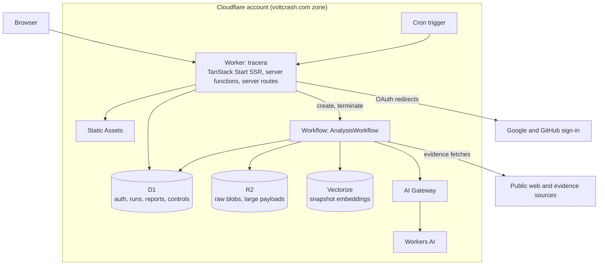

# Cloudflare migration plan

Status: proposed, 2026-10-11.

Tracera moves from Next.js + Hono on Vercel with Neon Postgres to a single TanStack Start
application running on one Cloudflare Worker, backed by D1, R2, Vectorize, Workers AI, AI
Gateway, and Workflows. Local development and production follow the oxytype model: one Worker
codebase, one Wrangler config per hosted environment, `.dev.vars` files for secrets, and
Wrangler-managed D1 migrations.

## 1. Goals and non-goals

Goals:

- Serve the website, authentication, API, and analysis pipeline from one Worker on
  `tracera.voltcrash.com`.
- Replace Hono with TanStack Start server functions, server routes, and middleware.
- Replace Neon Postgres and pgvector with D1, Vectorize for embeddings, and R2 for raw blobs.
- Replace third-party AI providers with Workers AI behind AI Gateway.
- Run local development on the production runtime (workerd through the Cloudflare Vite
  plugin), and delete the Docker, profile, role, and generated-configuration tooling.

Non-goals:

- No change to analysis semantics, `@repo/contracts` report shapes, scoring, or visual design.
- No new product features beyond what the platform change requires (see D9 for local
  fixture analysis).

## 2. What changes

| Concern            | Today                                                                                    | Target                                                                                         |
| ------------------ | ---------------------------------------------------------------------------------------- | ---------------------------------------------------------------------------------------------- |
| Framework          | Next.js 16 App Router, RSC, `proxy.ts`                                                   | TanStack Start (React 19, file routes, SSR), built by Vite+                                    |
| API                | Hono app behind `app/api/[[...route]]`                                                   | Start server functions for UI calls, server routes for HTTP-shaped endpoints, Start middleware |
| Hosting            | Vercel project, Node runtime, `maxDuration` 300 s                                        | One Worker with Workers Static Assets and a custom domain                                      |
| Database           | Neon Postgres 18 via `pg` and Neon serverless, 31 migrations, roles and grants           | D1 via Drizzle's `d1` driver, one new baseline migration                                       |
| Embeddings         | pgvector `vector(1024)` column                                                           | Vectorize index (1024 dimensions, cosine) plus a D1 metadata row                               |
| Raw blobs          | Filesystem store                                                                         | R2 bucket                                                                                      |
| AI                 | Gemini, OpenAI, OpenRouter, Anthropic, OpenAI-compatible APIs with keys                  | Workers AI binding through AI Gateway                                                          |
| Analysis execution | Inside `POST /analyze`, with Postgres job leases, fencing tokens, and renew timers       | One Workflow instance per run; the request returns the run ID                                  |
| Maintenance        | None                                                                                     | Cron trigger on the same Worker                                                                |
| Configuration      | `@repo/environment` profiles and roles, sealed files under `.tracera/`, `TRACERA_*` vars | `wrangler.jsonc` vars and `.dev.vars`; `wrangler.production.json` and `.dev.vars.production`   |
| Local data         | Per-worktree Docker Postgres clusters with generated ports and passwords                 | Miniflare D1, R2, and Workflows in `apps/web/.wrangler/state`, isolated per worktree           |
| Integration tests  | Docker Postgres rehearsal, grants audit, node-postgres suites                            | Miniflare D1 suites applying the real migrations (oxytype `createTestRuntime` pattern)         |
| Deployment         | Vercel Git integration                                                                   | `wrangler deploy` from GitHub Actions with a scoped `CLOUDFLARE_API_TOKEN`                     |

## 3. Target architecture



### Bindings and resources

| Binding             | Type                         | Staging and local (`wrangler.jsonc`)                | Production (`wrangler.production.json`) |
| ------------------- | ---------------------------- | --------------------------------------------------- | --------------------------------------- |
| Worker              | Worker name                  | `tracera-staging` (workers.dev)                     | `tracera` (custom domain only)          |
| `DB`                | D1                           | `tracera-staging` (local copy in `.wrangler/state`) | `tracera-production`                    |
| `BLOBS`             | R2                           | `tracera-staging-blobs` (local copy)                | `tracera-production-blobs`              |
| `SNAPSHOT_VECTORS`  | Vectorize, 1024-d, cosine    | `tracera-staging-snapshots` (remote only)           | `tracera-production-snapshots`          |
| `AI`                | Workers AI via AI Gateway    | gateway `tracera-staging` (remote only)             | gateway `tracera-production`            |
| `ANALYSIS_WORKFLOW` | Workflow, `AnalysisWorkflow` | `tracera-staging-analysis` (local in dev)           | `tracera-production-analysis`           |
| `ASSETS`            | Static assets                | managed by the Cloudflare Vite plugin               | same                                    |

Both configs set `compatibility_flags: ["nodejs_compat"]`, `observability.enabled`, and a cron
trigger. Production disables `workers_dev` and preview URLs and routes
`tracera.voltcrash.com` as a custom domain.

### Source layout after migration

```text
apps/web/
  vite.config.ts               # vite-plus defineConfig: cloudflare(), tanstackStart(), react(), tailwindcss()
  wrangler.jsonc               # default: staging resources, used locally with local data
  wrangler.production.json     # production, used only by explicit production scripts
  .dev.vars.example            # committed local defaults; copied to ignored .dev.vars
  .dev.vars.production.example # committed placeholders; real file is ignored, mode 0600
  worker-configuration.d.ts    # `wrangler types` output
  public/                      # favicon, icons, OG image
  src/
    server.ts                  # Worker entry: Start fetch, scheduled, AnalysisWorkflow export
    start.ts                   # createStart: global request and function middleware
    router.tsx
    routeTree.gen.ts           # generated by the Start plugin
    routes/                    # pages and /api server routes
    server/                    # env, auth, middleware, server functions, workflow, cron
    components/ lib/ styles/   # ported with minimal changes
packages/
  ai/                # Workers AI provider, R2 blob store, Worker-safe fetch
  auth/              # Better Auth on D1
  contracts/         # unchanged
  db/                # Drizzle sqlite schema, D1 repositories, migrations/
  typescript-config/ # nextjs.json removed
```

## 4. Local and production model (oxytype pattern)

1. One Worker codebase. Environment differences live only in Wrangler config and secrets files.
2. `apps/web/wrangler.jsonc` is the default config. It names the staging resources, and local
   development uses local copies of them (D1, R2, and Workflows run in Miniflare). Its `vars`
   hold staging values.
3. Ignored `apps/web/.dev.vars`, copied from the committed `.dev.vars.example`, overrides vars
   and supplies secrets for local development only: `MODE=dev`, `ANALYSIS_MODE=fixture`,
   `DEV_AUTH_BYPASS=true`, and a fixed local-only `BETTER_AUTH_SECRET`.
4. `apps/web/wrangler.production.json` is a separate, explicit config with isolated resources,
   `secrets.required`, and the custom-domain route. It is never the default.
5. Production secrets live in ignored `apps/web/.dev.vars.production` (mode 0600) and are
   uploaded with `wrangler deploy --secrets-file`. CI writes that file from one GitHub secret
   and deletes it afterwards, even on failure.
6. `check:production` validates the production config, secrets file, and build before every
   production deploy (a port of oxytype's `production-inputs.ts`): resource names and IDs differ
   from staging, one HTTPS origin, `MODE=production`, no `DEV_AUTH_BYPASS`, no fixture mode,
   no placeholder or local secrets, a long enough auth secret, and complete OAuth pairs.
7. `MODE` (`dev` or `production`) is the only runtime switch. It replaces `TRACERA_PROFILE`,
   `TRACERA_CONFIG_ROLE`, and `NODE_ENV` checks. Dev-only behavior requires `MODE=dev` and a
   loopback request origin.
8. Server code reads bindings with `import { env } from "cloudflare:workers"`, validated once by
   `apps/web/src/server/env.ts` with Zod. There is no `process.env` and no `.env` loading.

Parallel worktrees need no generated configuration: each worktree keeps its own
`apps/web/.wrangler/state`. The dev server prefers port 3000 and Vite moves to the next free
port when it is taken. In dev, Better Auth derives its base URL from the loopback request
origin, so any port works; production uses the fixed `BETTER_AUTH_URL`.

Workers AI and Vectorize have no local simulator. They are remote bindings to the staging
resources and are only called when `ANALYSIS_MODE=live`, so the default local workflow needs no
Cloudflare login and incurs no AI usage.

### Commands

Run from the repository root with `vp run <script>` unless noted.

| Task                 | Command                                                                      | What it does                                                                                 |
| -------------------- | ---------------------------------------------------------------------------- | -------------------------------------------------------------------------------------------- |
| First-time setup     | `vp install`, copy `apps/web/.dev.vars.example` to `.dev.vars`, `db:migrate` | Installs, configures, and migrates local D1                                                  |
| Develop              | `dev`                                                                        | `vp dev` in `apps/web`: Vite and workerd with HMR, local D1, R2, and Workflows               |
| Develop with live AI | `dev:live`                                                                   | Same, with `ANALYSIS_MODE=live`; needs `wrangler login` and uses staging AI and Vectorize    |
| Generate migration   | `db:generate`                                                                | `drizzle-kit generate` with the sqlite dialect                                               |
| Migrate local        | `db:migrate`                                                                 | `wrangler d1 migrations apply tracera-staging --local`                                       |
| Reset local data     | `db:reset`                                                                   | Deletes this worktree's local D1 state and migrates again                                    |
| Binding types        | `cf-typegen`                                                                 | `wrangler types`                                                                             |
| Check and test       | `vp check`, `vp test`                                                        | Format, lint, types, unit and Miniflare D1 suites                                            |
| Build and preview    | `build`, `preview`                                                           | `vp build`, then `vp preview` runs the built Worker in workerd                               |
| Deploy staging       | `deploy:staging`                                                             | Remote staging migrations, then `wrangler deploy`                                            |
| Check production     | `check:production`                                                           | Validates production config, secrets, and build                                              |
| Production dry run   | `deploy:production-dry-run`                                                  | Check, build, `wrangler deploy --config wrangler.production.json --secrets-file … --dry-run` |
| Migrate production   | `db:migrate:production`                                                      | `wrangler d1 migrations apply tracera-production --remote --config wrangler.production.json` |
| Deploy production    | `deploy:production`                                                          | Check, build, deploy with the production config and secrets file                             |

### Variables

| Today                                                                                                                                                                                           | Target                                                                                  |
| ----------------------------------------------------------------------------------------------------------------------------------------------------------------------------------------------- | --------------------------------------------------------------------------------------- |
| `BETTER_AUTH_SECRET`                                                                                                                                                                            | Secret (`.dev.vars` locally)                                                            |
| `GOOGLE_CLIENT_ID`, `GOOGLE_CLIENT_SECRET`, `GITHUB_CLIENT_ID`, `GITHUB_CLIENT_SECRET`                                                                                                          | Secrets in staging and production only                                                  |
| `GOOGLE_FACT_CHECK_API_KEY`, `NEWS_API_KEY`                                                                                                                                                     | Optional secrets, kept only if D4 keeps those sources                                   |
| `DEV_AUTH_BYPASS`                                                                                                                                                                               | `.dev.vars` only; rejected by `check:production`                                        |
| `TRACERA_ANALYSIS_MODE`                                                                                                                                                                         | `ANALYSIS_MODE` (`fixture` or `live`)                                                   |
| `AI_MODEL`, `AI_EMBEDDING_MODEL`                                                                                                                                                                | Vars holding Workers AI model IDs; add `AI_VISION_MODEL` if needed, and `AI_GATEWAY_ID` |
| `ANALYSIS_*` limits, `AI_DAILY_SPEND_LIMIT_USD`, `AI_ESTIMATED_*_COST_USD`                                                                                                                      | Optional vars; code defaults unchanged                                                  |
| —                                                                                                                                                                                               | New: `MODE`, `BETTER_AUTH_URL`, `VERSION`                                               |
| `TRACERA_PROFILE`, `TRACERA_CONFIG_ROLE`, `TRACERA_CONFIG_SEAL`, `TRACERA_CONFIG_SOURCE`, `TRACERA_WORKTREE_ID`, `TRACERA_DATABASE_*`, `TRACERA_APP_ORIGIN`, `TRACERA_APP_PORT`                 | Removed                                                                                 |
| `DATABASE_URL`, `DATABASE_MIGRATOR_URL`, `TEST_DATABASE_PROVISIONER_URL`, `ANALYSIS_STORAGE_TEST_DATABASE_URL`                                                                                  | Removed; D1 is a binding                                                                |
| `AI_PROVIDER`, `AI_API_KEY`, `AI_BASE_URL`, `AI_EMBEDDING_PROVIDER`, `AI_EMBEDDING_API_KEY`, `AI_EMBEDDING_BASE_URL`, and provider keys (`GEMINI_*`, `OPENAI_*`, `ANTHROPIC_*`, `OPENROUTER_*`) | Removed; Workers AI is a binding                                                        |

## 5. Decisions

| ID  | Decision                        | Recommendation                                                                                                                                                                                                                                                                                                         | Status   |
| --- | ------------------------------- | ---------------------------------------------------------------------------------------------------------------------------------------------------------------------------------------------------------------------------------------------------------------------------------------------------------------------- | -------- |
| D1  | Delivery strategy               | Stages 0–1 are additive and merge to `main` (Vercel keeps serving). Stages 2–3 land as one PR per phase into `migrate/cloudflare`. `main` and Vercel stay untouched until cutover; freeze feature work on `main` meanwhile.                                                                                            | Proposed |
| D2  | API surface                     | Server functions for everything the React UI calls. Server routes only where the HTTP shape matters: `/api/auth/$`, SSE progress, evidence download, health. No CORS: dev and production are both same-origin.                                                                                                         | Proposed |
| D3  | Analysis execution              | Workflows. `startAnalysis` returns the run ID and the run page streams progress. Retires the Postgres job queue, leases, fencing renewals, timers, and outbox.                                                                                                                                                         | Proposed |
| D4  | "Nothing from outside" boundary | All infrastructure and AI run on Cloudflare. Google and GitHub sign-in and the public pages being checked are inherently external. Google News RSS, GDELT, Google Fact Check, and NewsAPI are external evidence data with no Cloudflare equivalent; keep them, since dropping them limits evidence to submitted links. | Open     |
| D5  | AI models                       | Workers AI through AI Gateway, external providers removed. Models chosen by the Phase 0.3 bake-off with the existing evaluation harness. Embedding candidate `@cf/baai/bge-m3` (1024-d, multilingual) keeps `EMBEDDING_DIMENSIONS = 1024`. The D1 spend circuit stays, using reported token usage where available.     | Proposed |
| D6  | Existing production data        | New D1 baseline (Postgres migrations are not ported). Migrate users, accounts, and report history; migrate sessions only if `BETTER_AUTH_SECRET` is kept, otherwise users sign in once. Do not migrate embeddings (the model changes).                                                                                 | Open     |
| D7  | Concurrency on D1               | Atomic `batch()` calls with guarded statements and optimistic version columns, as in oxytype. No interactive transactions. A Durable Object only if a guard cannot be expressed in one batch.                                                                                                                          | Proposed |
| D8  | Config layout                   | Separate `wrangler.production.json` instead of Wrangler `env` blocks; secrets through `--secrets-file`. Mirrors oxytype.                                                                                                                                                                                               | Proposed |
| D9  | Local analysis                  | `MODE=dev` with `ANALYSIS_MODE=fixture` runs the deterministic scripted ports end to end, so the whole UI works offline. `live` is opt-in. Production rejects fixture mode.                                                                                                                                            | Proposed |
| D10 | Test runtime                    | Miniflare inside Vitest (oxytype) rather than `@cloudflare/vitest-pool-workers`, to stay on Vite+'s bundled Vitest.                                                                                                                                                                                                    | Proposed |
| D11 | Fonts                           | Self-host Newsreader with `@fontsource-variable/newsreader`; keep the local Geist files. No Google Fonts download at build time.                                                                                                                                                                                       | Proposed |
| D12 | Database privileges             | Postgres roles, grants, and the RLS analysis are retired. Only the Worker binding can reach D1; migrations use a scoped API token. Application-level tenant, owner, and visibility filters stay.                                                                                                                       | Proposed |

## 6. Stages and phases

Each phase is one pull request. Every pull request passes `vp check` and `vp test`; tests for a
removed subsystem leave with that subsystem, and their replacement coverage lands in the same
or the named next phase.

### Stage 0 — Decide and prove

No product code lands in this stage.

**Phase 0.1 — Sign off decisions.** Resolve D4 and D6, set the D5 quality bar, and record the
outcome in this document. Exit: every decision in section 5 is accepted or amended.

**Phase 0.2 — Toolchain spike (throwaway branch).** Build a minimal TanStack Start app in this
workspace with `vp dev` and `vp build` using `@cloudflare/vite-plugin` on Vite+'s Vite core.
Prove:

- SSR and HMR inside workerd; Tailwind v4 through `@tailwindcss/vite`.
- `routeTree.gen.ts` generation and `vp check` type-aware lint with generated files.
- A custom `src/server.ts` exporting a `WorkflowEntrypoint` and a `scheduled` handler.
- Local D1 through Drizzle, and Better Auth's sqlite adapter on D1 with `tanstackStartCookies()`.
- A per-request CSP nonce applied to Start's inline scripts.

Record any Vite+ incompatibility and its fix on current versions; no downgrades. Exit: written
spike notes and a go or no-go.

**Phase 0.3 — Workers AI bake-off.** Put a temporary Workers AI adapter behind the existing
`AiProvider` interface. Run the fixture evaluators for contract coverage and the live release
evaluation against two or three Workers AI candidates, covering structured JSON generation,
screenshot input, and 1024-dimension embeddings. Compare against the current provider's
scores. Exit: chosen `AI_MODEL`, `AI_VISION_MODEL` (if separate), and `AI_EMBEDDING_MODEL`, with
recorded scores.

**Phase 0.4 — Cloudflare resources.** Create the staging and production resources in
section 3, including Vectorize indexes (`--dimensions=1024 --metric=cosine`, metadata indexes on
`tenantId`, `ownerUserId`, and `visibility`) and both AI Gateways. Register staging OAuth apps
for Google and GitHub with `<staging origin>/api/auth/callback/{google,github}`. Create a CI API
token scoped to Workers, D1, R2, Vectorize, Workflows, AI Gateway, and the custom domain. Exit:
resource names and IDs ready for the Wrangler configs.

### Stage 1 — Cloudflare foundations in shared packages

Additive changes merged to `main`. Nothing on Vercel changes.

**Phase 1.1 — Worker-safe `@repo/ai` runtime.**

- Rewrite `safeFetch` on Web `fetch` with `redirect: "manual"` and validation on every hop:
  protocol and port allowlist, hostname and IP-literal blocklists, and a resolved-address check
  through `node:dns` as defense in depth. Remove `node:http`, `node:https`, `node:net`, and
  `node:stream`. Workers cannot reach private networks, so DNS pinning is no longer needed.
- Add `createR2RawBlobStore(bucket)` implementing `RawBlobStore`, with content-addressed keys
  (`snapshots/<snapshotId>/<sha256>`) and `r2://` URIs. The filesystem store moves to test
  support.
- Confirm Cheerio bundles for workerd without its Node-only fetching path; `node:crypto`
  `createHash` stays under `nodejs_compat`.

Exit: package tests pass, and a Miniflare smoke test runs ingestion through `safeFetch` and R2.

**Phase 1.2 — Workers AI provider.**

- Add `WorkersAiProvider` implementing `AiProvider` over the `Ai` binding with
  `{ model, visionModel, embeddingModel, gatewayId }`. Structured output uses JSON Schema from
  the Zod contract with the existing validation and retry loop; images pass as data; `embed`
  asserts 1024 dimensions.
- Add `workers-ai` to `AiProviderConfig`. External providers stay until Stage 3.
- Map Workers AI token usage to spend where it is reported; fall back to the existing estimates.

Exit: unit tests with a fake `Ai` binding; bake-off models configured.

**Phase 1.3 — D1 schema and baseline migration.**

- `packages/db/src/d1/schema.ts` defines every live table with `sqliteTable` using the mappings
  in appendix B. Tables that exist only for in-request execution (`core_jobs`, `core_outbox`,
  lease columns) are left out because Workflows own execution (D3).
- Better Auth's sqlite tables are generated with the Better Auth CLI and reconciled into the
  schema.
- A sqlite Drizzle config generates `packages/db/migrations/0000_baseline.sql`; both Wrangler
  configs point `migrations_dir` at that folder.

Exit: migrations apply cleanly through Miniflare and `wrangler d1 migrations apply --local`.

**Phase 1.4 — D1 repositories.**

- Implement the analysis repository on D1: run creation, checkpoints, snapshots, finalize,
  report reads, run progress and history, and cancellation. A `fencing_token` on the run row,
  updated conditionally, guards finalization.
- Implement analysis admission and provider spend (`beginAnalysisAdmission`,
  `finishAnalysisAdmission`, `reserveProviderSpend`, `settleProviderSpend`) as single atomic D1
  batches using guarded `INSERT … ON CONFLICT … DO UPDATE … WHERE … RETURNING`. Clock values and
  UTC day keys come from code.
- Apply the rewrite rules in appendix C.
- Store embeddings with a Vectorize upsert keyed by snapshot ID with tenant, owner, and
  visibility metadata. D1 keeps `{ snapshotId, model, dimensions, sha256 }` for idempotency,
  replacing the `embedding = $n::vector` comparison.

Exit: Miniflare D1 suites ported from `analysis-storage.integration.test.ts` and
`postgres.integration.test.ts` pass, including rate, concurrency, quota, cooldown, idempotent
replay, and spend-circuit behavior under concurrent batches.

**Phase 1.5 — Better Auth on D1.**

- `createAuth({ db, env, origin })` uses `drizzleAdapter(db, { provider: "sqlite" })` and keeps
  the `tracera` cookie prefix, OAuth token encryption, token-discarding hooks, and Google and
  GitHub providers.
- The dev-login plugin requires `MODE=dev`, `DEV_AUTH_BYPASS=true`, and a loopback origin.
- `tanstackStartCookies()` is the last plugin. `@repo/environment` assertions are replaced by
  typed input.

Exit: ported `dev-auth-bypass` and `auth-token-storage` tests pass against Miniflare D1.

### Stage 2 — The app on TanStack Start and Workers

Pull requests target `migrate/cloudflare`.

**Phase 2.1 — Framework swap and the oxytype config model.**

- Remove `next`, `next.config.js`, `postcss.config.mjs`, `src/proxy.ts`, the Next agent notes
  in `apps/web/AGENTS.md` and `apps/web/CLAUDE.md`, and the root `next` dev dependency.
- Add TanStack Start, TanStack Router, `@cloudflare/vite-plugin`, `@vitejs/plugin-react`,
  `@tailwindcss/vite`, and `wrangler` with `vp add` at their latest versions.
- Add `vite.config.ts`, both Wrangler configs, both `.dev.vars` examples, `src/server.ts`,
  `src/start.ts`, `src/router.tsx`, `src/server/env.ts`, the scripts in section 4, and ignore
  rules for `.wrangler/` and real `.dev.vars*` files.

Exit: `dev`, `build`, `preview`, and `wrangler deploy --dry-run` work, and a placeholder page is
served from workerd with local D1 migrated.

**Phase 2.2 — Pages, layout, and navigation.**

- Port routes and Next APIs per appendix A.
- The root route renders `<html>`, `head()` metadata (title, Open Graph, Twitter, theme color,
  icons), fonts, the theme bootstrap script with the nonce, and the providers.
- Remove the 25 `"use client"` directives; set `rsc: false` and the new CSS path in
  `components.json`; move icons and the Open Graph image to `public/`.
- The `_workspace` layout's `beforeLoad` calls a `getSession` server function and redirects
  anonymous users to `/`; `/` redirects signed-in users to `/home`. This replaces `proxy.ts`.

Exit: every page renders under `vp dev` with navigation parity.

**Phase 2.3 — Auth endpoints.**

- `src/routes/api/auth/$.ts` handles GET and POST with `auth.handler(request)` and keeps the
  existing mapping of 5xx responses to the generic error body.
- Dev identities stay a dev-only Better Auth plugin endpoint. `authClient` is unchanged.

Exit: local sign-in as `ada@tracera.local` and `grace@tracera.local` works, persists across
reloads, and signs out.

**Phase 2.4 — Server layer replacing Hono.**

| Hono today                                                        | TanStack Start                                                                                                  |
| ----------------------------------------------------------------- | --------------------------------------------------------------------------------------------------------------- |
| `requestIdMiddleware`, `onError`                                  | Global request middleware: request ID header, JSON error envelope, server-function error mapping                |
| Security headers and CSP in `server.ts` and `proxy.ts`            | Global request middleware with a per-request nonce                                                              |
| `private, no-store` for authenticated or cookie-setting responses | Same global middleware                                                                                          |
| `cors()` and `cors-origin.ts`                                     | Removed                                                                                                         |
| `authenticatedUser` and the per-request `WeakMap` cache           | `authMiddleware` function middleware putting `user` in context                                                  |
| `configureDatabase(...)` per request                              | `db()` from `env.DB`                                                                                            |
| `GET /api/tracera/`                                               | Removed                                                                                                         |
| `GET /auth/me`                                                    | `getMe` server function                                                                                         |
| `GET /health`                                                     | `/api/health` server route                                                                                      |
| `POST /analyze`                                                   | `startAnalysis` server function: input and idempotency key in, `{ runId, status }` or a typed control error out |
| `GET /runs`, `GET /runs/:id`, `POST /runs/:id/cancel`             | `listRuns`, `getRun` (also used by the route loader), `cancelRun`                                               |
| `GET /runs/:id/events`                                            | `/api/runs/$id/events` server route, same SSE event format                                                      |
| `GET /runs/:id/evidence/:snapshotId`                              | `/api/runs/$id/evidence/$snapshotId` server route reading D1 and R2                                             |

The 7.1 MB analysis body limit moves into the `startAnalysis` input validator. Route loaders
replace fetch-on-mount where it simplifies a page; no new data library is added.

Exit: ported `analysis-api`, `error-handling`, and route-guard tests pass by invoking server
function and route handlers against a Miniflare environment.

**Phase 2.5 — Analysis on Workflows.**

- Export `AnalysisWorkflow extends WorkflowEntrypoint` from `src/server.ts` and bind it in both
  configs.
- `startAnalysis` admits the request in one D1 batch, creates the run row, calls
  `env.ANALYSIS_WORKFLOW.create({ id: runId, params })`, and returns the run ID. Using the run ID
  as the instance ID makes starts idempotent.
- The workflow runs `step.do("analyze")` with retries and a timeout of `ANALYSIS_MAX_ELAPSED_MS`.
  The engine already checkpoints each stage, so a retried step resumes after the last completed
  stage. `step.do("finalize")` writes the report and `step.do("release")` stores the idempotent
  response, releases the admission lease, and settles spend. Splitting each engine stage into
  its own step is an optional follow-up.
- `cancelRun` sets the D1 cancellation flag, which the engine already observes, and terminates
  the instance after a grace period.
- Removed: `acquireLease`, `renewLease`, `acquireNextLease`, the renew and cancellation timers,
  and `process.pid` worker IDs.
- In fixture mode the workflow uses the scripted ports from `packages/ai/scripts/support`.
- The home page navigates to `/run/$id` after `startAnalysis`; the run page shows live progress
  and then the report.

Exit: a local fixture analysis completes end to end in `vp dev`, cancellation works, and an
injected failure resumes from its checkpoint.

**Phase 2.6 — Retrieval and evidence on Workers.** The live search ports keep their behavior on
the new `safeFetch`. Fact Check and NewsAPI keys are optional secrets per D4. Raw blobs go to R2
and embeddings to Vectorize. Browser Rendering is added only if the bake-off shows acquisition
gaps on script-rendered pages. Exit: `dev:live` completes an analysis against staging AI and
Vectorize.

**Phase 2.7 — Scheduled maintenance.** The `scheduled` handler purges expired idempotency keys,
released and expired leases, old rate windows, expired sessions and verifications, and stale
spend reservations, and marks runs whose workflow instance errored as failed. Exit: covered by
Miniflare tests and runnable locally.

**Phase 2.8 — Browser tests.** Playwright starts `vp dev` on a fixed port with `--strictPort`
and cleans its synthetic users with `wrangler d1 execute --local`. `local-auth.e2e.ts` and
`focused-acceptance.e2e.ts` are ported; acceptance can use fixture analysis instead of mocking
the API. Exit: both suites pass locally and in CI.

### Stage 3 — Remove the old stack, docs, and CI/CD

Pull requests target `migrate/cloudflare`.

**Phase 3.1 — Delete legacy code and dependencies.**

- Hono: `apps/web/src/server/{index,server,auth-routes,base-path,cors-origin}.ts` and `hono`.
- Postgres: `packages/db/src/connection.ts`, the Postgres schema, `packages/db/drizzle/` (31
  migrations and snapshots), `@neondatabase/serverless`, `pg`, `@types/pg`, and Postgres tests.
  D1 modules move from `src/d1/` to `src/`.
- Environment tooling: `packages/environment`, `scripts/environment`, `scripts/database`,
  `scripts/local`, `scripts/auth/test-browser.mjs`, `config/environment`, root `.env.example`,
  and the `.tracera/` ignore rule.
- External AI: `providers/anthropic.ts`, `providers/gemini.ts`,
  `providers/openai-compatible.ts`, `composite-provider.ts`, provider parsing in
  `analysis-runtime.ts`, and their variables.
- Vercel and Next: `vercel.json`, `.vercel` and `.next` ignore rules, the oxlint `nextjs`
  plugin, and `packages/typescript-config/nextjs.json`.
- Update `pnpm-workspace.yaml` `allowBuilds` for the new dependency set and trim root scripts to
  section 4.

Exit: `vp install`, `vp check`, `vp test`, and `build` pass, and no source references Next,
Hono, Neon, `pg`, Vercel, `DATABASE_URL`, or `TRACERA_PROFILE`.

**Phase 3.2 — Documentation.** Rewrite the README stack, architecture diagram, and quick start.
Replace `docs/environment.md` and `docs/local-development.md` with oxytype-style
`docs/cloudflare-operations.md` (local development, bindings, secrets, migrations, staging
deploys, recovery, D1 Time Travel), `docs/production-setup.md`, and `docs/staging-setup.md`.
Mark this plan complete.

**Phase 3.3 — CI and production release.**

- `.github/workflows/ci.yml` replaces `local-development.yml`: install, Chromium, `vp check`,
  `vp test` under `with-network-denied.sh`, `build`, `wrangler deploy --dry-run` for both
  configs, and Playwright against `vp dev`. No Docker.
- `.github/workflows/production-release.yml` follows oxytype: a `production` environment with
  `CLOUDFLARE_API_TOKEN` and `PRODUCTION_WORKER_ENV` (the contents of `.dev.vars.production`);
  write the file with mode 0600, `check:production`, build, dry run, `db:migrate:production`,
  deploy with `--var VERSION:<sha>`, and always delete the file.

Exit: CI passes on `migrate/cloudflare` and the release workflow succeeds in dry-run mode.

### Stage 4 — Staging, data, cutover, decommission

**Phase 4.1 — Staging soak.** Deploy staging and set its secrets. In a browser, check Google and
GitHub sign-in, text, link, and screenshot analysis, progress streaming, cancellation, evidence,
run history, linked accounts in settings, sign-out, and CSP violations. Exercise rate limits,
concurrency limits, idempotent replay, daily quota, and the spend circuit. Review Workers logs,
workflow instances, AI Gateway logs, and D1 metrics, and run the live evaluation against
staging. Exit: checklist signed off.

**Phase 4.2 — Data migration (if D6 keeps data).** A one-shot script exports from Neon on the
operator's machine, converts types per appendix B, writes chunked SQL, and imports with
`wrangler d1 execute --remote --file`. Rehearse on staging, then verify production row counts
and spot-check reports. Archive a final `pg_dump` in R2. The script is deleted afterwards.

**Phase 4.3 — Production cutover.**

1. Turn off Vercel Git deployments.
2. Merge `migrate/cloudflare` into `main`, with the production deploy job waiting on
   environment approval.
3. Pause writes on Vercel, then run `db:migrate:production` and the data import.
4. Approve the deploy. The Worker's custom domain takes over `tracera.voltcrash.com` after the
   Vercel DNS record is removed.
5. Smoke-test production. OAuth callback URLs do not change because the origin and paths stay
   the same.
6. Watch logs for 24 to 48 hours.

Rollback until decommission: remove the custom domain and restore the Vercel DNS record. Writes
made to D1 after cutover would not exist in Neon, so keep this window short and agree on it in
advance.

**Phase 4.4 — Decommission.** After the agreed stable period, delete the Vercel project and its
variables and the Neon project (after the archive is verified), revoke the external AI keys,
and remove Vercel and Neon secrets from GitHub. Run and document a D1 Time Travel restore drill.

## Appendix A — Next.js to TanStack Start

| Next.js                                                   | TanStack Start                                                          |
| --------------------------------------------------------- | ----------------------------------------------------------------------- |
| `app/layout.tsx`                                          | `routes/__root.tsx`; `head()` replaces `metadata` and `viewport`        |
| `app/(marketing)/page.tsx`                                | `routes/index.tsx` with a signed-in redirect in `beforeLoad`            |
| `app/(workspace)/layout.tsx`                              | `routes/_workspace.tsx`, a pathless layout with the auth guard          |
| `app/(workspace)/home/page.tsx`                           | `routes/_workspace/home.tsx`                                            |
| `app/(workspace)/run/[id]/page.tsx` and `run-detail.tsx`  | `routes/_workspace/run.$id.tsx` with a `getRun` loader                  |
| `app/(workspace)/settings/page.tsx`                       | `routes/_workspace/settings.tsx`                                        |
| `app/(auth)/auth/complete`, `auth/error`                  | `routes/auth/complete.tsx`, `routes/auth/error.tsx` (public)            |
| `app/(auth)/reset-password`, `verify-email`               | `routes/reset-password.tsx`, `routes/verify-email.tsx`                  |
| `app/api/[[...route]]/route.ts`                           | Server routes under `routes/api/` and server functions (Phase 2.4)      |
| `app/favicon.ico`, `icon.svg`, `apple-icon.png`           | `public/` and explicit `<link>` tags in the root `head()`               |
| `app/fonts/*.woff`, `next/font/local`, `next/font/google` | `@font-face` with Vite asset URLs and `@fontsource-variable/newsreader` |
| `src/proxy.ts`                                            | Request middleware in `start.ts` and route `beforeLoad` guards          |
| `next/link` `Link`                                        | `Link` from `@tanstack/react-router`                                    |
| `useRouter().push` / `.replace` / `.refresh`              | `useNavigate()`, `navigate({ replace: true })`, `router.invalidate()`   |
| `usePathname()`, `useSearchParams()`                      | `useLocation().pathname`, `Route.useSearch()` with `validateSearch`     |
| `redirect()`, `headers()`                                 | `throw redirect({ to })`, `getRequest()` or middleware context          |
| `next/image`                                              | `` with explicit dimensions                                        |
| `"use client"`                                            | Removed                                                                 |

## Appendix B — Postgres to D1 types

| Postgres                                  | D1 (Drizzle sqlite)                                                        |
| ----------------------------------------- | -------------------------------------------------------------------------- |
| `uuid` with `defaultRandom()`             | `text`, generated with `crypto.randomUUID()`                               |
| `timestamptz`                             | `integer({ mode: "timestamp_ms" })`                                        |
| `date` (UTC day)                          | `text` in `YYYY-MM-DD`, computed in code                                   |
| `jsonb`                                   | `text({ mode: "json" })`, plus a SHA-256 column where equality is compared |
| `boolean`                                 | `integer({ mode: "boolean" })`                                             |
| `numeric(12, 6)` USD amounts              | `integer` micro-dollars                                                    |
| `numeric(8, 5)` factual score             | `real`                                                                     |
| `vector(1024)`                            | Vectorize, plus a D1 metadata row                                          |
| Roles, grants, and RLS notes (0024, 0029) | None; binding-scoped access with application-level filters                 |
| `drizzle-kit migrate` as the migrator     | `wrangler d1 migrations apply`                                             |

## Appendix C — Postgres idioms on D1

| Postgres                                | D1                                                                                       |
| --------------------------------------- | ---------------------------------------------------------------------------------------- |
| `BEGIN … SELECT … FOR UPDATE … COMMIT`  | One `batch()` of guarded writes; D1 serializes writes, so a batch is atomic and isolated |
| `FOR UPDATE SKIP LOCKED` job claiming   | Not needed; Workflows own execution                                                      |
| `= ANY($1::text[])`                     | `IN (SELECT value FROM json_each(?))` with one JSON array parameter                      |
| `jsonb` equality checks                 | Compare stored SHA-256 of canonical JSON                                                 |
| `NOW()`, `AT TIME ZONE 'UTC'`, `::date` | Clock values and UTC day keys passed as parameters                                       |
| `gen_random_uuid()`                     | `crypto.randomUUID()`                                                                    |
| `::text`, `::jsonb`, `::vector` casts   | Removed; Drizzle column modes handle conversion                                          |
| Large `jsonb` rows                      | Payloads over 1.5 MB go to R2 with a D1 pointer (D1 rows are capped at 2 MB)             |
| Many bound parameters                   | Chunk statements or use `json_each`; D1 allows 100 bound parameters per statement        |

## Risks

| Risk                                                                   | Mitigation                                                                             |
| ---------------------------------------------------------------------- | -------------------------------------------------------------------------------------- |
| Vite+'s Vite core is incompatible with the Cloudflare or Start plugins | Phase 0.2 go or no-go; fix forward on current versions                                 |
| Workers AI quality falls short of the current provider                 | Phase 0.3 bake-off with explicit thresholds before any production switch               |
| D1 has no interactive transactions or row locks                        | Guarded single batches (D7) with concurrency tests in Phase 1.4                        |
| D1 limits: 2 MB rows, 100 bound parameters, 10 GB per database         | R2 offload, `json_each`, chunking, and size monitoring in the operations doc           |
| Worker CPU limits                                                      | The pipeline is I/O-bound; Workflow steps allow up to 5 minutes of CPU when configured |
| Node-only code paths in dependencies                                   | Phase 1.1 Miniflare smoke tests                                                        |
| AI and Vectorize have no local simulator                               | Fixture mode by default (D9); remote bindings only for `dev:live`                      |
| Rolling back after cutover loses D1 writes                             | A short, pre-agreed rollback window                                                    |
| `migrate/cloudflare` drifts from `main`                                | Feature freeze on `main`; additive Stage 0–1 work lands on `main` first                |

## Open questions

1. D4: keep Google News RSS, GDELT, Google Fact Check, and NewsAPI as evidence sources?
2. D6: migrate production users, accounts, sessions, and report history, or start fresh?
3. D5: what score threshold must Workers AI meet, and is an external model through AI Gateway
   acceptable if no Workers AI model passes?
4. Staging origin: the workers.dev URL or `tracera-staging.voltcrash.com`?
5. Production deploys: on every merge to `main`, or oxytype's daily release?
